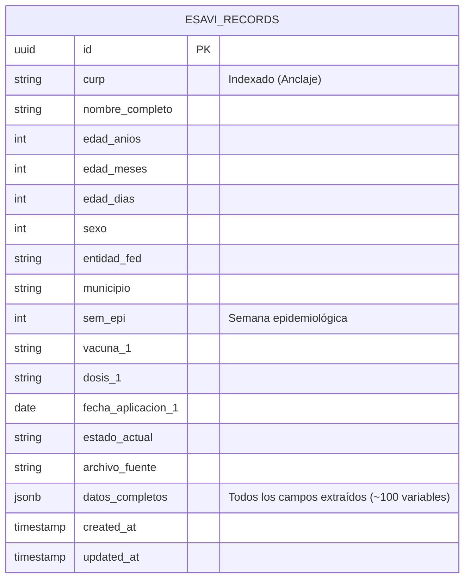

# ARQUITECTURA TÉCNICA Y ESPECIFICACIÓN DE STACK: SISTEMA ESAVI V2

> **Instrucción para el Agente de IA**: Este documento define la arquitectura, stack tecnológico, dependencias, modelo de datos y reglas de negocio para el desarrollo del sistema **ESAVI v2**. Utiliza estas especificaciones de forma estricta para diseñar los módulos, bases de datos, endpoints y vistas.

---

## 1. RESUMEN DEL SISTEMA Y OBJETIVOS

- **Propósito**: Ingesta por lotes (1 a $N$ archivos) de formatos clínicos `.xlsx`/`.xlsm` de ESAVI (Eventos Supuestamente Atribuibles a la Vacunación o Inmunización), almacenamiento relacional persistente, analítica descriptiva/gráfica y exportación de concentrados acumulativos con orden de columnas configurable.
- **Volumen Operativo**: ~50 a 200 archivos/año (~3 a 5 mensuales).
- **Entorno de Despliegue**: 3 Nodos en Hetzner Cloud (Red Privada):
  - **Nodo 1 (Edge / Gateway)**: Caddy (Terminación SSL + Reverse Proxy).
  - **Nodo 2 (App)**: FastAPI en contenedor Docker.
  - **Nodo 3 (DB)**: PostgreSQL 16 (Instancia persistente existente).

---

## 2. STACK TECNOLÓGICO Y DEPENDENCIAS COMPLETAS

### 2.1 Backend y Motor de Datos (Python 3.11+)

Archivo `requirements.txt` completo para el Nodo 2:

```txt
# Core Framework & Servidor
fastapi==0.115.0
uvicorn[standard]==0.30.6
python-multipart==0.0.9
pydantic==2.9.2
pydantic-settings==2.5.2
jinja2==3.1.4

# Base de Datos & ORM
sqlalchemy==2.0.35
alembic==1.13.3
psycopg2-binary==2.9.9

# Motor de Extracción & Análisis
pandas==2.2.3
openpyxl==3.1.5
xlsxwriter==3.2.0

# Utilidades & Seguridad
python-dotenv==1.0.1
```

### 2.2 Frontend & UI (Monolito Liviano / Cero Node.js)

Se adopta una arquitectura basada en **FastAPI + Jinja2 + TailwindCSS + HTMX + Chart.js** servida directamente vía CDN o estáticos locales:

| Componente | Biblioteca / Recurso | Propósito |
| :--- | :--- | :--- |
| **Estilos & Layout** | Tailwind CSS (CDN / Play CDN o CLI minificado) | Sistema de diseño responsivo, cards, tablas y modales. |
| **Interactividad Asíncrona** | HTMX (`2.0.x`) | Subida de archivos por lotes con feedback dinámico y filtrado de tablas sin recargar página. |
| **Arrastrar y Soltar (Upload)** | FilePond o Dropzone.js | Componente UI para carga múltiple drag-and-drop con indicadores de progreso individual por archivo. |
| **Visualización Gráfica** | Chart.js (`4.4.x`) + Chartjs-Plugin-Datalabels | Gráficas de barras, líneas (serie temporal epidemiológica), donas (distribución por vacuna) y pirámides etarias. |
| **Iconografía** | Lucide Icons / Heroicons (SVG/CDN) | Iconos de interfaz claros y modernos. |

---

## 3. MODELO DE DATOS HÍBRIDO (PostgreSQL)

Para garantizar integridad en datos demográficos clave sin perder la flexibilidad de los más de 100 campos cambiantes de síntomas, se utiliza un modelo **Relacional + JSONB**:



### 3.1 Cláusula de Unicidad / Control de Duplicados
- Índice único compuesto: `UNIQUE(curp, fecha_aplicacion_1, vacuna_1)`.
- Si se vuelve a subir un archivo idéntico, el sistema debe ofrecer opción de **Ignorar** o **Actualizar/Sobrescribir**.

---

## 4. MOTOR DE EXTRACCIÓN Y LÓGICA DE COORDENADAS

### 4.1 Especificación de Lectura
- **Hoja objetivo**: `"Registro"`.
- **Desplazamiento inicial**: `skiprows=7` (La fila 8 del Excel es la fila 0 del DataFrame).
- **Validación de anclaje obligatoria**: Verificar que en la celda `coordenadas["CURP"]` (0, 4) exista un valor con formato válido de 15 a 20 caracteres alfanuméricos antes de extraer el resto.
- **Tratamiento del Nombre**: Reconstruir el nombre completo a partir de las celdas contiguas `((2, 4), (2, 15), (2, 26))`.
- **Campos descartados/placeholders**: Toda coordenada `(0, 0)` distinta de CURP debe registrarse como `None`.

---

## 5. GENERACIÓN DEL CONCENTRADO ACUMULATIVO

### 5.1 Especificación del Concentrador
1. El usuario puede solicitar la descarga del concentrado histórico completo o filtrado por fechas/semana epidemiológica.
2. El orden de columnas se define en un archivo de configuración desacoplado (`config/concentrado_columns.json`):
   ```json
   [
     "Folio:", "CURP", "Nombre", "Edad_Anios", "Sexo", "Entidad_Fed", "Municipio",
     "Sem_Epi", "vacuna", "dosis", "fecha_aplicacion_dia_mes_ano",
     "descripcion_cuadro_clinico", "estado_actual"
   ]
   ```
3. El servicio `ExporterService` consulta PostgreSQL, desanida los campos desde el `JSONB` o columnas indexadas, ordena las columnas según la lista configurada y genera un libro `.xlsx` con estilos mediante **XlsxWriter**.

---

## 6. TOPOLOGÍA DE RED Y DESPLIEGUE (Hetzner 3 Nodos)

```text
[ Internet ] 
     │
     ▼ HTTPS (:443)
[ Nodo 1: Gateway Caddy (IP Pública: xx.xx.xx.xx) ]
     │
     ▼ Red Privada Hetzner (10.0.0.0/16) - HTTP (:8000)
[ Nodo 2: Aplicación FastAPI / Docker (IP Privada: 10.0.0.2) ]
     │
     ▼ Red Privada Hetzner (10.0.0.0/16) - TCP (:5432)
[ Nodo 3: PostgreSQL 16 (IP Privada: 10.0.0.3) ]
```

### 6.1 Directiva Caddyfile (Nodo 1)
```caddy
esavi.tudominio.com {
    request_body {
        max_size 50MB
    }
    reverse_proxy 10.0.0.2:8000
}
```

---

## 7. ESTRUCTURA DE ARCHIVOS SUGERIDA PARA EL NUEVO PROYECTO

```text
esavi-v2/
├── app/
│   ├── api/
│   │   ├── routes_upload.py     # Endpoints POST /upload (batch 1 a N)
│   │   ├── routes_analytics.py  # Endpoints GET /metrics (datos para Chart.js)
│   │   └── routes_export.py     # Endpoints GET /export/excel (concentrado)
│   ├── core/
│   │   ├── config.py            # Pydantic BaseSettings (.env)
│   │   └── database.py          # SQLAlchemy Session & Engine
│   ├── extractor/
│   │   ├── coordenadas.py       # Diccionario completo de celdas
│   │   └── engine.py            # Clase ESAVIExtractor
│   ├── models/
│   │   └── esavi.py             # Modelo ORM con columnas indexadas + JSONB
│   ├── services/
│   │   ├── ingestion_service.py # Lógica de inserción/duplicados
│   │   ├── analytics_service.py # Agregaciones y KPIs epidemiológicos
│   │   └── export_service.py    # Generador de Excel con XlsxWriter
│   ├── templates/
│   │   ├── base.html
│   │   ├── dashboard.html       # Gráficas y KPIs acumulados
│   │   ├── upload.html          # Drag and drop de múltiples archivos
│   │   └── records.html         # Tabla acumulativa con filtros
│   ├── static/
│   │   ├── css/
│   │   └── js/                  # Inicialización de Dropzone y Chart.js
│   └── main.py                  # Entrypoint FastAPI
├── config/
│   └── concentrado_columns.json # Definición del orden de exportación
├── migrations/                  # Alembic
├── Dockerfile
├── docker-compose.yml
├── requirements.txt
└── README.md
```
